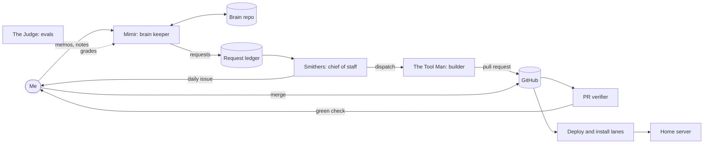

# agent-engine

I'm Andrew Brooks, a software product and delivery leader. On my own time and my own hardware I
built a working multi-agent engine: a team of Claude agents on an always-on home server that
keeps a shared memory (the brain), turns what I ask for into tracked requests, writes designs and
code, and reports to me once a day. Agents don't ship anything themselves. Their changes arrive as
pull requests, an automated verifier tests each one in a sandbox, I merge, and the merge is the
deploy. This repo explains the design and shares the patterns and tools that came out of it. The
engine itself runs from a private repo.

## What it does

- **Keeps a brain.** Mimir, the brain keeper, files my voice memos and notes into a git repo of
  core facts, summary cards, and raw sources, and answers lookups from any agent session.
- **Turns requests into outcomes.** A request I speak into a memo gets an ID, a state, and an
  owner. Research starts on its own; anything that opens a PR, spends money, contacts a person, or
  changes a live system waits for my yes.
- **Builds through pull requests.** The Tool Man, a sandboxed builder with no network and no
  credentials, writes the change; separate root-owned code checks its output and opens the PR.
- **Verifies every PR without GitHub's runners.** The PR verifier runs secret scans, lint, and
  tests in locked-down containers on the home server and posts the check I merge on.
- **Deploys on merge.** Two lanes watch `main`: one redeploys container stacks, the other installs
  changed components as root, each with checks, a backup, and a rollback.
- **Reports once a day.** Smithers, the chief of staff, posts one daily issue with what needs me,
  under a daily cap on questions, and I answer in it with short verbs.
- **Measures itself.** Every model run is logged, every build run ends with a usage report, and an
  evaluation agent grades the other agents.

## Numbers (from the private repo's git history)

| Measure | Value | As of |
|---|---|---|
| Days since the first commit (2026-09-20) | 51 | 2026-11-10 |
| Merged pull requests | 435 | 2026-11-10 |
| Recorded decision entries (each dated, with its source) | 244 | 2026-11-10 |

## The system

Everything above except me and GitHub runs on one home server. The design doc covers each role's
limits, the life of a request, and the trust model.

## How to read this repo

- [`docs/design.md`](docs/design.md): the architecture, the roles and their limits, the life of a
  request, and the trust model.
- [`docs/patterns/`](docs/patterns/): short write-ups of the patterns, each with the problem, the
  decision, the tradeoff, and what broke.
- [`tools/`](tools/): five standalone tools with tests: a log-fragment fold, a coherence check,
  a session usage report, a local check runner, and the private-term scan.
- [`STARTER.md`](STARTER.md): a prompt you fill in for your own setup to get a build roadmap.
- [`docs/checks.md`](docs/checks.md): how this repo keeps private material out.

This repo doesn't take issues or pull requests. To reach me, use the contact details on
[andrewbrooks.fyi](https://andrewbrooks.fyi). MIT licensed; see [`LICENSE`](LICENSE).
