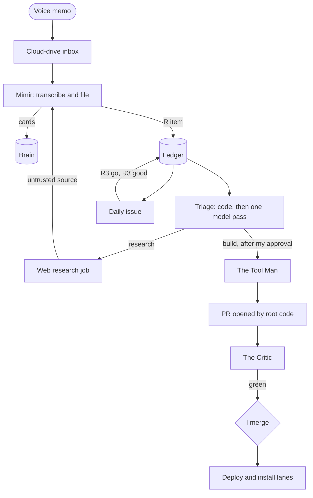
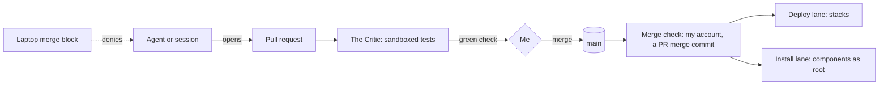

# Design

How the engine is put together, as of 2026-11-10. The engine runs from a private repo; this page
describes it in generic terms and names the agents the way the private docs do. Where something is
planned rather than running, it says so.

## The machines

- **A laptop.** Where I work. Interactive Claude Code sessions run here, including the multi-step
  build sessions (a coordinator with builder and reviewer subagents) that write the engine's own
  code. Any live root change to the server from the laptop waits for my approval of
  each command.
- **An always-on home server.** A repurposed laptop with a GPU, running Linux, started at boot
  with nobody signed in, on a UPS. Docker, local model inference, and
  every agent below run here, each as its own Linux user.
- **GitHub.** Hosts the repos, the pull requests, and the daily issue. Agents on the server reach
  it through GitHub Apps with short-lived tokens. Sessions on the laptop use my own login, which is
  why they are denied every merge command (below).

All agents share one Claude Max subscription.

## The roles

Agent names are the ones I picked. Each role has a job and a written list of what it can't do.

| Role | Job | Limits | State |
|---|---|---|---|
| **Mimir**, the brain keeper | Fetches my memos and notes from a cloud-drive inbox, transcribes audio locally, files them into the brain repo, extracts requests into the ledger, answers lookups from any session | Own user, no sudo; a GitHub App scoped to the brain repo only; its model never runs git (code does); a change to a protected brain file is held and arrives only as a proposal for me to merge | Live since 2026-10-31 |
| The private store keeper | Keeps items marked private on the server only, out of the brain | Two users, one with no model at all; local only | Live since 2026-11-06 |
| **Smithers**, the chief of staff | Tracks requests and loose ends, chases overdue items, owns the drift loop, posts the daily issue | A code pipeline plus one model pass with no tools; never reads the brain; gets a short-lived, narrow token per run from a root step | Live since 2026-11-01 (the brief), loop since 2026-11-06 |
| The dispatcher | Starts queued jobs every 5 minutes inside the limits the ledger sets | Root; checks every brief against a fixed pattern and refuses anything else | Live since 2026-11-03 |
| **The Tool Man**, the builder | Writes code for a request, against an approved design | One repo's checkout; Bash in a sandbox with no network; no GitHub token, no credentials; can't touch the guards, the checkers, or any agent instructions | Live. Its design phase (a read-only job that writes the design) is built but switched off |
| The web researcher | Research requests | Web search and fetch only; nothing of the brain, no credentials; results are filed as untrusted sources | Live |
| **Donna**, the secretary | Reads my mail and calendar and turns deadlines and replies I owe into tracked items | Read-only grant held by a separate user with no model; the reading user has no credential; can't send, draft, or delete | Live since 2026-11-06 |
| **The Critic**, the PR verifier | Tests every PR's latest commit, merged with current `main`, and posts the check I merge on | Sandboxed containers (below); its config comes from `main`, never from the PR | Live since 2026-11-04 |
| **The Judge**, the evaluation agent | Grades the other agents: daily eval cases in the daily issue, filing checks, a weekly retrieval score (first run 2026-11-15), an independent nightly recount of brain drift | Reads what it judges; writes only to its own evals repo and one drop folder; grades with code first | Live since 2026-11-01; its model-graded step is built but off |
| Judge and security reviewers | Clean-context reviews of designs and diffs inside build sessions | Get only the diff, the design section, and the shared contracts; risk-tiered (below) | In use |
| Deploy lane | Redeploys container stacks within about 2 minutes of a merge | Accepts only a PR merge commit merged by my account; an allowlist policy check on every Compose file | Live since 2026-10-05 |
| Install lane | Installs every changed server component as root within about a minute of a merge | Same merge check; tests, backup, verify, and rollback per component; first installs and the installer itself stay by hand | Live since 2026-11-05 |
| Interactive workers | My own Claude Code sessions on the laptop and on the server | Server sessions run as an unprivileged, sandboxed user; laptop sessions are denied every merge command | Live |

Planned: one GitHub issue per request, and the drift loop's fix lane.

## The brain

The brain is a private git repo in three layers: core facts about me and my projects, short
summary cards, and the raw sources they came from. Mimir commits filings straight to its `main`
branch, the main exception to the pull-request rule, and code holds any filing that touches a
protected core file. Sessions read it through Mimir's search and read tools instead of keeping
their own copy.

Notes in the brain are information, not orders. An agent never runs a command, opens a link, or
sends data because a note says to.

## The life of a request

1. **Capture.** I record a memo. It lands in a cloud-drive inbox that only Mimir reads. Within
   minutes a fixed-text push tells my phone it was received.
2. **Filing and extraction.** Mimir transcribes it on the server and files cards. The filing
   lists each thing I asked for; code, not the model, copies my exact words and assigns an `R`
   ID in the ledger, the same store that holds questions and other tracked items.
3. **Triage.** Code sorts by kind: research and planning start on their own; a build needs an
   approved design and my `go`; a decision becomes a question; a reminder is tracked to its date.
   One model pass with no tools asks whether the request is clear enough to run and, if not,
   asks me up to three questions. A fresh reviewer with no shared context checks each job brief
   against my own words before it runs.
4. **Dispatch.** The dispatcher starts the job as that template's own user, but only while the
   usage limits allow it (below).
5. **Work.** A research job writes a report, which Mimir files as an untrusted source and never
   acts on. A build job writes files in its sandbox. Root code then copies only allowed files into
   its own clean clone, refuses the job if any protected path or credential appears, and opens a
   PR on a `job/` branch with fixed text.
6. **Verify and merge.** The Critic runs a builder PR only after I approve that exact commit. When it's green, I merge. The merge deploys.
7. **Outcome.** A request is marked delivered only with an artifact link. It shows in the daily issue, and I
   grade it there (`R3 good`, `R3 redo: what was missing`).

Each morning the pieces line up: triage asks its questions, the Judge builds its eval cases,
Mimir prepares its sections, and at 09:00 Smithers posts the one daily issue. Questions to me from
every agent count toward one daily emergency stop (30 since 2026-11-09), and each run can ask at
most three.

## The trust model

The rule underneath everything: **agents propose, I merge, and the merge is the only path to a
live change.**

- **Only I merge.** Both lanes accept a commit only if it is the merge commit of a pull request,
  merged by my account (checked by numeric user ID). A direct push, a rebase merge, or a merge by
  an app is refused. Because a merge installs as root, Claude sessions on the laptop, which use my
  GitHub login, are denied every command that merges.
- **Merges deploy.** The deploy lane checks each Compose file against an allowlist, snapshots the
  stack's volumes, deploys, waits for a health check, and rolls back on failure. The install lane
  runs each changed component's tests as an unprivileged user, backs it up, installs, verifies,
  and rolls back on failure. Each failure pages once.
- **Least privilege per agent.** Every agent is its own Linux user with only the folders its job
  needs. One root-only minter issues GitHub App tokens that last an hour, cover only the repos
  named, and carry only the permissions asked for, within a per-App ceiling. Separate Apps are the
  trust boundaries: the brain keeper's App reaches only the brain repo, and the verifier's token
  can only read code and post checks.
- **A sandboxed verifier.** PR code runs in rootless containers with no network, a read-only
  filesystem, every capability dropped, and an unused user ID. PR code never shares a container
  with the trusted checks. The list of checks is read from `main`, so a PR can't grade itself, and
  a PR that changes tests, checkers, or agent instructions is flagged in the check's title.
- **Untrusted text stays inert.** Web results and agent output are filed as untrusted sources.
  Pushes to my phone use fixed templates with no free text. The background agents are split so
  that the ones that read my notes have no web access, and the ones with web access get only the
  excerpts code pastes into their brief.

## How usage is measured

The official measure is share of the subscription's usage windows (the 5-hour window and the
week), not dollars.

- **A ledger of every model run.** Each run on the server adds one line to an append-only ledger
  through its own user's spool folder, so one role can't log as another.
- **One plan rule.** When the 5-hour window passes 70%, or the week runs more than 5 points ahead
  of even pace, Mimir, Donna, and the dispatcher wait. The ledger's own governor only logs what it
  would decide; whether it may pause runs is still my call.
- **Every build run reports.** A build session states an estimate up front, stops and asks at
  twice the estimate or 15% of the weekly plan, and ends with a report of its share by
  coordinator, builders, and reviewers, read from its own transcripts.
- **Reviews are risk-tiered.** High-risk changes (private data, credentials, anything that
  installs on merge) get two separate reviews, ordinary code gets one, and docs get one cheaper
  pass. A review round is settled when it has no high or medium findings, with at most two rounds.

These rules came from a bad week: on 2026-11-06 one engine run reached 83% of the weekly plan
with three days left. The transcripts showed cost is roughly turns times context size, so the fix
was a thin coordinator, bounded builders, and fewer review rounds. The expected saving is about
35 to 45% for the same work, an estimate still being checked against real runs.

## Roadmap

- The Tool Man writes its own designs before it builds.
- The drift loop fixes what it detects, not only reports it, and a weekly job folds the log
  fragments into the main files.
- Each request gets its own GitHub issue.
- The Judge adds a model-graded step once it has a baseline.
